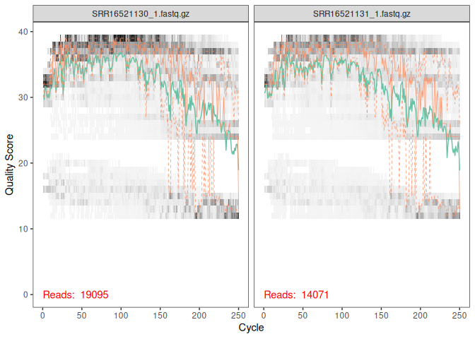
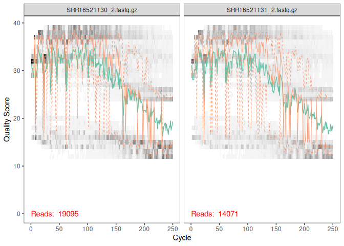
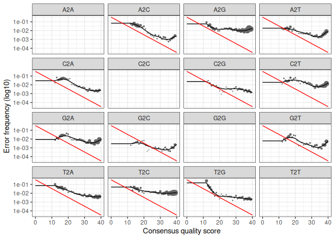

CC2 APO : Article du début jusqu’à Phyloseq
================
Antoine
2026-10-07

``` r
# Lire le fichier CSV contenant le tableau des métadonnées des échantillons
tableau<- read.csv("data/SraRunTable.csv")
```

``` r
# Charger le package DADA2
library(dada2); packageVersion("dada2")
```

    ## Loading required package: Rcpp

    ## [1] '1.40.0'

``` r
# Charger DADA2
library(dada2)

# Chemin vers les données
path <- "data"
```

``` r
# Identifier les fichiers R1 et R2
fnFs <- sort(list.files(path, pattern = "_1.fastq.gz$", full.names = TRUE))
fnRs <- sort(list.files(path, pattern = "_2.fastq.gz$", full.names = TRUE))
```

``` r
# Sélectionner les 100 premiers fichiers de chaque liste(consigne du prof vu qu'il y'en avait 500 dans l'article choisi)
#on garde garde les 100 premiers fichiers R1 et R2
fnFs <- fnFs[1:100]
fnRs <- fnRs[1:100]

# Extraire l'identifiant de chaque échantillon (partie avant le premier "_")
sample.names <- sapply(strsplit(basename(fnFs), "_"), `[`, 1)
```

``` r
#afficher les profils de qualité des deux premiers fichiers R1
plotQualityProfile(fnFs[1:2])
```

<!-- --> 0 à 160 pb :
La qualité moyenne reste au-dessus ou proche de 30, et les quartiles
restent stables.

160-170 pb : La moyenne commence à descendre sous 30, et le bas du
quartile décroche très fortement vers des scores de 10-15.

Au-delà de 200 pb : La qualité chute sous 25 de manière généralisée.

Couper à truncLen = 160 permet de garder le maximum de séquences propres
avant que les erreurs n’augmentent de trop.

``` r
# afficher les profils de qualité des deux premiers fichiers R2
plotQualityProfile(fnRs[1:2])
```

<!-- -->

Jusqu’à 140–150 pb : La moyenne oscille péniblement autour de 30, mais
les quartiles bas tombent déjà sous 20 dès les premiers cycles. Fwd =
160 et Rev = 140

FILTER AND TRIM

``` r
# Définir les chemins de sortie pour les fichiers R1 filtrés
filtFs <- file.path(path, "filtered", paste0(sample.names, "_F_filt.fastq.gz"))

# Définir les chemins de sortie pour les fichiers R2 filtrés
filtRs <- file.path(path, "filtered", paste0(sample.names, "_R_filt.fastq.gz"))

# Associer chaque chemin de sortie R1 à son nom d'échantillon
names(filtFs) <- sample.names

# Associer chaque chemin de sortie R2 à son nom d'échantillon
names(filtRs) <- sample.names
```

``` r
# Filtrer les séquences R1 et R2 et enregistrer les fichiers filtrés
out <- filterAndTrim(
  fnFs, filtFs,       # Fichiers R1 : entrée puis sortie
  fnRs, filtRs,       # Fichiers R2 : entrée puis sortie
  truncLen = c(160, 140), # Conserver 160 bases pour R1 et 140 pour R2
  maxN = 0,           # Éliminer les reads contenant au moins une base inconnue (N)
  maxEE = c(2, 2),    # Accepter au maximum 2 erreurs attendues pour R1 et R2
  truncQ = 2,         # Tronquer les reads à partir d'une base de qualité <= 2
  rm.phix = TRUE,     # Retirer les séquences PhiX
  compress = TRUE,    # Compresser les fichiers de sortie en .gz
  multithread = FALSE # Ne pas utiliser le traitement parallèle
)

# Afficher les premières lignes du bilan de filtrage
head(out)
```

    ##                        reads.in reads.out
    ## SRR16521130_1.fastq.gz    19095     17679
    ## SRR16521131_1.fastq.gz    14071     12629
    ## SRR16521132_1.fastq.gz      191       146
    ## SRR16521133_1.fastq.gz    16443     14868
    ## SRR16521134_1.fastq.gz    18109     16979
    ## SRR16521135_1.fastq.gz    23526     21841

Learn the Error Rates

``` r
# Apprendre le modèle d'erreurs de séquençage à partir des fichiers R1 filtrés
errF <- learnErrors(filtFs, multithread=FALSE)
```

    ## 101562720 total bases in 634767 reads from 40 samples will be used for learning the error rates.

``` r
# Apprendre le modèle d'erreurs de séquençage à partir des fichiers R2 filtrés
errR <- learnErrors(filtRs, multithread=FALSE)
```

    ## 101357760 total bases in 723984 reads from 45 samples will be used for learning the error rates.

``` r
plotErrors(errF, nominalQ=TRUE)
```

    ## Warning in scale_y_log10(): log-10 transformation introduced infinite values.

    ## Warning: Removed 164 rows containing missing values or values outside the scale range
    ## (`geom_line()`).
    ## Removed 164 rows containing missing values or values outside the scale range
    ## (`geom_line()`).

<!-- -->

Sample Inference

``` r
#Repérer les vrai séquences d’ADN présentes , en distinguant les différences des erreurs de lecture pour R1
dadaFs <- dada(filtFs, err=errF, multithread=TRUE)
```

    ## Sample 1 - 17679 reads in 9968 unique sequences.
    ## Sample 2 - 12629 reads in 8337 unique sequences.
    ## Sample 3 - 146 reads in 92 unique sequences.
    ## Sample 4 - 14868 reads in 8506 unique sequences.
    ## Sample 5 - 16979 reads in 9291 unique sequences.
    ## Sample 6 - 21841 reads in 11355 unique sequences.
    ## Sample 7 - 22934 reads in 12517 unique sequences.
    ## Sample 8 - 14045 reads in 7577 unique sequences.
    ## Sample 9 - 15040 reads in 8223 unique sequences.
    ## Sample 10 - 23213 reads in 12616 unique sequences.
    ## Sample 11 - 14851 reads in 7988 unique sequences.
    ## Sample 12 - 17724 reads in 9583 unique sequences.
    ## Sample 13 - 15554 reads in 8611 unique sequences.
    ## Sample 14 - 20611 reads in 12555 unique sequences.
    ## Sample 15 - 14603 reads in 7881 unique sequences.
    ## Sample 16 - 20134 reads in 10880 unique sequences.
    ## Sample 17 - 10898 reads in 6182 unique sequences.
    ## Sample 18 - 17201 reads in 9461 unique sequences.
    ## Sample 19 - 12744 reads in 7310 unique sequences.
    ## Sample 20 - 15902 reads in 8744 unique sequences.
    ## Sample 21 - 15206 reads in 8520 unique sequences.
    ## Sample 22 - 14309 reads in 7710 unique sequences.
    ## Sample 23 - 10395 reads in 5819 unique sequences.
    ## Sample 24 - 11419 reads in 6525 unique sequences.
    ## Sample 25 - 19256 reads in 11864 unique sequences.
    ## Sample 26 - 11391 reads in 6542 unique sequences.
    ## Sample 27 - 14838 reads in 8104 unique sequences.
    ## Sample 28 - 11897 reads in 6625 unique sequences.
    ## Sample 29 - 17449 reads in 9611 unique sequences.
    ## Sample 30 - 13477 reads in 7227 unique sequences.
    ## Sample 31 - 14859 reads in 8035 unique sequences.
    ## Sample 32 - 20179 reads in 10998 unique sequences.
    ## Sample 33 - 15228 reads in 8856 unique sequences.
    ## Sample 34 - 14872 reads in 9771 unique sequences.
    ## Sample 35 - 17133 reads in 10620 unique sequences.
    ## Sample 36 - 16090 reads in 10354 unique sequences.
    ## Sample 37 - 20035 reads in 12505 unique sequences.
    ## Sample 38 - 20261 reads in 12416 unique sequences.
    ## Sample 39 - 19580 reads in 12321 unique sequences.
    ## Sample 40 - 17297 reads in 10905 unique sequences.
    ## Sample 41 - 17870 reads in 11013 unique sequences.
    ## Sample 42 - 18641 reads in 11400 unique sequences.
    ## Sample 43 - 15484 reads in 10099 unique sequences.
    ## Sample 44 - 16257 reads in 9861 unique sequences.
    ## Sample 45 - 20965 reads in 13136 unique sequences.
    ## Sample 46 - 17802 reads in 11054 unique sequences.
    ## Sample 47 - 15079 reads in 9950 unique sequences.
    ## Sample 48 - 17415 reads in 10810 unique sequences.
    ## Sample 49 - 19093 reads in 11648 unique sequences.
    ## Sample 50 - 14654 reads in 9202 unique sequences.
    ## Sample 51 - 16867 reads in 10408 unique sequences.
    ## Sample 52 - 11664 reads in 7616 unique sequences.
    ## Sample 53 - 14437 reads in 9305 unique sequences.
    ## Sample 54 - 12986 reads in 8625 unique sequences.
    ## Sample 55 - 15574 reads in 9656 unique sequences.
    ## Sample 56 - 14205 reads in 9333 unique sequences.
    ## Sample 57 - 14461 reads in 9026 unique sequences.
    ## Sample 58 - 16263 reads in 10070 unique sequences.
    ## Sample 59 - 11091 reads in 7380 unique sequences.
    ## Sample 60 - 11812 reads in 7819 unique sequences.
    ## Sample 61 - 16909 reads in 10669 unique sequences.
    ## Sample 62 - 13935 reads in 8876 unique sequences.
    ## Sample 63 - 15301 reads in 9765 unique sequences.
    ## Sample 64 - 15852 reads in 10028 unique sequences.
    ## Sample 65 - 18208 reads in 11023 unique sequences.
    ## Sample 66 - 16143 reads in 9971 unique sequences.
    ## Sample 67 - 16940 reads in 11051 unique sequences.
    ## Sample 68 - 17219 reads in 10778 unique sequences.
    ## Sample 69 - 15145 reads in 9961 unique sequences.
    ## Sample 70 - 16515 reads in 10722 unique sequences.
    ## Sample 71 - 15095 reads in 9979 unique sequences.
    ## Sample 72 - 14968 reads in 9908 unique sequences.
    ## Sample 73 - 19509 reads in 12652 unique sequences.
    ## Sample 74 - 17999 reads in 11344 unique sequences.
    ## Sample 75 - 15039 reads in 8661 unique sequences.
    ## Sample 76 - 11301 reads in 6422 unique sequences.
    ## Sample 77 - 18681 reads in 11911 unique sequences.
    ## Sample 78 - 15382 reads in 8547 unique sequences.
    ## Sample 79 - 14311 reads in 7942 unique sequences.
    ## Sample 80 - 15552 reads in 9072 unique sequences.
    ## Sample 81 - 18285 reads in 11246 unique sequences.
    ## Sample 82 - 11045 reads in 6483 unique sequences.
    ## Sample 83 - 14527 reads in 8372 unique sequences.
    ## Sample 84 - 17059 reads in 10146 unique sequences.
    ## Sample 85 - 12982 reads in 7264 unique sequences.
    ## Sample 86 - 19710 reads in 11001 unique sequences.
    ## Sample 87 - 14770 reads in 8319 unique sequences.
    ## Sample 88 - 19352 reads in 12151 unique sequences.
    ## Sample 89 - 19502 reads in 10499 unique sequences.
    ## Sample 90 - 14640 reads in 8395 unique sequences.
    ## Sample 91 - 11472 reads in 6482 unique sequences.
    ## Sample 92 - 13492 reads in 7664 unique sequences.
    ## Sample 93 - 15932 reads in 8911 unique sequences.
    ## Sample 94 - 14867 reads in 8224 unique sequences.
    ## Sample 95 - 13164 reads in 7642 unique sequences.
    ## Sample 96 - 11024 reads in 6265 unique sequences.
    ## Sample 97 - 13198 reads in 7361 unique sequences.
    ## Sample 98 - 15351 reads in 8630 unique sequences.
    ## Sample 99 - 16471 reads in 10524 unique sequences.
    ## Sample 100 - 12118 reads in 7313 unique sequences.

``` r
dadaRs <- dada(filtRs, err=errR, multithread=TRUE)
```

    ## Sample 1 - 17679 reads in 11710 unique sequences.
    ## Sample 2 - 12629 reads in 9329 unique sequences.
    ## Sample 3 - 146 reads in 112 unique sequences.
    ## Sample 4 - 14868 reads in 9838 unique sequences.
    ## Sample 5 - 16979 reads in 9772 unique sequences.
    ## Sample 6 - 21841 reads in 13033 unique sequences.
    ## Sample 7 - 22934 reads in 14815 unique sequences.
    ## Sample 8 - 14045 reads in 8561 unique sequences.
    ## Sample 9 - 15040 reads in 9117 unique sequences.
    ## Sample 10 - 23213 reads in 14741 unique sequences.
    ## Sample 11 - 14851 reads in 9503 unique sequences.
    ## Sample 12 - 17724 reads in 10603 unique sequences.
    ## Sample 13 - 15554 reads in 9829 unique sequences.
    ## Sample 14 - 20611 reads in 14629 unique sequences.
    ## Sample 15 - 14603 reads in 9551 unique sequences.
    ## Sample 16 - 20134 reads in 12555 unique sequences.
    ## Sample 17 - 10898 reads in 6960 unique sequences.
    ## Sample 18 - 17201 reads in 10726 unique sequences.
    ## Sample 19 - 12744 reads in 7908 unique sequences.
    ## Sample 20 - 15902 reads in 9492 unique sequences.
    ## Sample 21 - 15206 reads in 9852 unique sequences.
    ## Sample 22 - 14309 reads in 8363 unique sequences.
    ## Sample 23 - 10395 reads in 6358 unique sequences.
    ## Sample 24 - 11419 reads in 7569 unique sequences.
    ## Sample 25 - 19256 reads in 13090 unique sequences.
    ## Sample 26 - 11391 reads in 7118 unique sequences.
    ## Sample 27 - 14838 reads in 9308 unique sequences.
    ## Sample 28 - 11897 reads in 7415 unique sequences.
    ## Sample 29 - 17449 reads in 11365 unique sequences.
    ## Sample 30 - 13477 reads in 8373 unique sequences.
    ## Sample 31 - 14859 reads in 8683 unique sequences.
    ## Sample 32 - 20179 reads in 12277 unique sequences.
    ## Sample 33 - 15228 reads in 10009 unique sequences.
    ## Sample 34 - 14872 reads in 10560 unique sequences.
    ## Sample 35 - 17133 reads in 12411 unique sequences.
    ## Sample 36 - 16090 reads in 12248 unique sequences.
    ## Sample 37 - 20035 reads in 14551 unique sequences.
    ## Sample 38 - 20261 reads in 14194 unique sequences.
    ## Sample 39 - 19580 reads in 13901 unique sequences.
    ## Sample 40 - 17297 reads in 12271 unique sequences.
    ## Sample 41 - 17870 reads in 12940 unique sequences.
    ## Sample 42 - 18641 reads in 13264 unique sequences.
    ## Sample 43 - 15484 reads in 11193 unique sequences.
    ## Sample 44 - 16257 reads in 11060 unique sequences.
    ## Sample 45 - 20965 reads in 15953 unique sequences.
    ## Sample 46 - 17802 reads in 13195 unique sequences.
    ## Sample 47 - 15079 reads in 11348 unique sequences.
    ## Sample 48 - 17415 reads in 12393 unique sequences.
    ## Sample 49 - 19093 reads in 13808 unique sequences.
    ## Sample 50 - 14654 reads in 10821 unique sequences.
    ## Sample 51 - 16867 reads in 12134 unique sequences.
    ## Sample 52 - 11664 reads in 8574 unique sequences.
    ## Sample 53 - 14437 reads in 10632 unique sequences.
    ## Sample 54 - 12986 reads in 10111 unique sequences.
    ## Sample 55 - 15574 reads in 10834 unique sequences.
    ## Sample 56 - 14205 reads in 10202 unique sequences.
    ## Sample 57 - 14461 reads in 10029 unique sequences.
    ## Sample 58 - 16263 reads in 11359 unique sequences.
    ## Sample 59 - 11091 reads in 8225 unique sequences.
    ## Sample 60 - 11812 reads in 8770 unique sequences.
    ## Sample 61 - 16909 reads in 12792 unique sequences.
    ## Sample 62 - 13935 reads in 10465 unique sequences.
    ## Sample 63 - 15301 reads in 10928 unique sequences.
    ## Sample 64 - 15852 reads in 11464 unique sequences.
    ## Sample 65 - 18208 reads in 12640 unique sequences.
    ## Sample 66 - 16143 reads in 11083 unique sequences.
    ## Sample 67 - 16940 reads in 11861 unique sequences.
    ## Sample 68 - 17219 reads in 12969 unique sequences.
    ## Sample 69 - 15145 reads in 11550 unique sequences.
    ## Sample 70 - 16515 reads in 11755 unique sequences.
    ## Sample 71 - 15095 reads in 10488 unique sequences.
    ## Sample 72 - 14968 reads in 10717 unique sequences.
    ## Sample 73 - 19509 reads in 14241 unique sequences.
    ## Sample 74 - 17999 reads in 13345 unique sequences.
    ## Sample 75 - 15039 reads in 9239 unique sequences.
    ## Sample 76 - 11301 reads in 6789 unique sequences.
    ## Sample 77 - 18681 reads in 12601 unique sequences.
    ## Sample 78 - 15382 reads in 9976 unique sequences.
    ## Sample 79 - 14311 reads in 8893 unique sequences.
    ## Sample 80 - 15552 reads in 9535 unique sequences.
    ## Sample 81 - 18285 reads in 11890 unique sequences.
    ## Sample 82 - 11045 reads in 7082 unique sequences.
    ## Sample 83 - 14527 reads in 10166 unique sequences.
    ## Sample 84 - 17059 reads in 10893 unique sequences.
    ## Sample 85 - 12982 reads in 7672 unique sequences.
    ## Sample 86 - 19710 reads in 12991 unique sequences.
    ## Sample 87 - 14770 reads in 10771 unique sequences.
    ## Sample 88 - 19352 reads in 13538 unique sequences.
    ## Sample 89 - 19502 reads in 11623 unique sequences.
    ## Sample 90 - 14640 reads in 11374 unique sequences.
    ## Sample 91 - 11472 reads in 6992 unique sequences.
    ## Sample 92 - 13492 reads in 8329 unique sequences.
    ## Sample 93 - 15932 reads in 11715 unique sequences.
    ## Sample 94 - 14867 reads in 9498 unique sequences.
    ## Sample 95 - 13164 reads in 8218 unique sequences.
    ## Sample 96 - 11024 reads in 7987 unique sequences.
    ## Sample 97 - 13198 reads in 8568 unique sequences.
    ## Sample 98 - 15351 reads in 10957 unique sequences.
    ## Sample 99 - 16471 reads in 11955 unique sequences.
    ## Sample 100 - 12118 reads in 8035 unique sequences.

``` r
dadaFs[[1]]
```

    ## dada-class: object describing DADA2 denoising results
    ## 227 sequence variants were inferred from 9968 input unique sequences.
    ## Key parameters: OMEGA_A = 1e-40, OMEGA_C = 1e-40, BAND_SIZE = 16

Merge paired reads

``` r
#Fusionner les séquences R1 et R2 correspondantes pour reconstituer les séquences complètes
mergers <- mergePairs(dadaFs, filtFs, dadaRs, filtRs, verbose=FALSE)

#affiche les premieres lignes
print(head(mergers[[1]]))
```

    ##                                                                                                                                                                                                                                                        sequence
    ## 1 TACGGGAGTGGCAAGCGTTATCCGGAATTATTGGGCGTAAAGCGTCCGCAGGCGGCTTTTCAAGTCTGCTGTTAAAGCGTGGAGCTTAACTCCATCATGGCAGTGGAAACTGAAAGGCTTGAGTATGGTAGGGGCAGAGGGAATTCCCGGTGTAGCGGTGAAATGCGTAGATATCGGGAAGAACACCAGTGGCGAAGGCGCTCTGCTGGGCCATTACTGACGCTCATGGACGAAAGCCAGGGGAGCGAAAGGG
    ## 2 TACGGGAGTGGCAAGCGTTATCCGGAATTATTGGGCGTAAAGCGTCCGCAGGCGGCTTTTCAAGTCTGCTGTTAAAACGTGGAGCTTAACTCCATCATGGCAGTGGAAACTGAAAGGCTTGAGTATGGTAGGGGCAGAGGGAATTCCCGGTGTAGCGGTGAAATGCGTAGATATCGGGAAGAACACCAGTGGCGAAGGCGCTCTGCTGGGCCATTACTGACGCTCATGGACGAAAGCCAGGGGAGCGAAAGGG
    ## 3 TACGAAGGGACCTAGCGTAGTTCGGAATTACTGGGCTTAAAGAGTTCGTAGGTGGTTGAAAAAGTTGGTGGTGAAATCCCAGAGCTTAACTCTGGAACTGCCATCAAAACTTTTCAGCTAGAGTTTGATAGAGGAAAGCAGAATTTCTAGTGTAGAGGTGAAATTCGTAGATATTAGAAAGAATACCAATTGCGAAGGCAGCTTTCTGGATCATTACTGACACTGAGGAACGAAAGCATGGGTAGCGAAGAGG
    ## 4 TACGAAGGGACCTAGCGTAGTTCGGAATTACTGGGCTTAAAGAGTTCGTAGGTGGTTGAAAAAGTTGGTGGTGAAATCCCAGAGCTTAACTCTGGAACTGCCATCAAAACTTTTCAGCTAGAGTATGATAGAGGAAAGCAGAATTTCTAGTGTAGAGGTGAAATTCGTAGATATTAGAAAGAATACCAATTGCGAAGGCAGCTTTCTGGATCATTACTGACACTGAGGAACGAAAGCATGGGTAGCGAAGAGG
    ## 5 TACGAAGGGACCTAGCGTAGTTCGGAATTACTGGGCTTAAAGAGTTCGTAGGTGGTTAAAAAAGTTGGTGGTGAAATCCCAGAGCTTAACTCTGGAACTGCCATCAAAACTTTTTAGCTAGAGTATGATAGAGGAAAGCAGAATTTCTAGTGTAGAGGTGAAATTCGTAGATATTAGAAAGAATACCAATTGCGAAGGCAGCTTTCTGGATCATTACTGACACTGAGGAACGAAAGCATGGGTAGCGAAGAGG
    ## 6 TACGAAGGGACCTAGCGTAGTTCGGAATTACTGGGCTTAAAGAGCTCGTAGGTGGTTAAAAAAGTTGATGGTGAAATCCCAAGGCTCAACCTTGGAACTGCCATCAAAACTTTTTAGCTAGAGTGTGATAGAGGTAAGTGGAATTTCTAGTGTAGAGGTGAAATTCGTAGATATTAGAAAGAACACCAAATGCGAAGGCAACTTACTGGGTCACTACTGACACTGAGGAGCGAAAGCATGGGTAGCGAAGAGG
    ##   abundance forward reverse nmatch nmismatch nindel prefer accept
    ## 1      3050       1       1     47         0      0      2   TRUE
    ## 2      1229       2       1     47         0      0      2   TRUE
    ## 3       635       4       2     47         0      0      1   TRUE
    ## 4       463      75      61     47         0      0      1   TRUE
    ## 5       449       3       3     47         0      0      1   TRUE
    ## 6       388       7       4     47         0      0      2   TRUE

Construct sequence table

``` r
#Construire une table regroupant les séquences fusionnées de tous les échantillons.
seqtab <- makeSequenceTable(mergers)

#dimesion de la table
dim(seqtab)
```

    ## [1]  100 3388

``` r
table(nchar(getSequences(seqtab)))
```

    ## 
    ##  190  195  196  199  206  232  248  249  250  251  252  253  254  255  256  257 
    ##    1    4    1    1    1    1    1    1    4    9  188 2906  229    9    6   10 
    ##  258  259  270  281  285 
    ##   12    1    1    1    1

Remove chimeras

``` r
# Retirer les séquences chimériques du tableau de séquences
seqtab.nochim <- removeBimeraDenovo(
  seqtab,
  method = "consensus",
  multithread = FALSE,
  verbose = TRUE
)
```

    ## Identified 47 bimeras out of 3388 input sequences.

``` r
dim(seqtab.nochim)
```

    ## [1]  100 3341

``` r
#Calculer la proportion des séquences conservées après le retrait des chimères
sum(seqtab.nochim)/sum(seqtab)
```

    ## [1] 0.9961334

Track reads through the pipeline

``` r
getN <- function(x) sum(getUniques(x))

track <- cbind(
  out,
  sapply(dadaFs, getN),
  sapply(dadaRs, getN),
  sapply(mergers, getN),
  rowSums(seqtab.nochim)
)

colnames(track) <- c(
  "input", "filtered", "denoisedF", "denoisedR",
  "merged", "nonchim"
)

rownames(track) <- sample.names
head(track)
```

    ##             input filtered denoisedF denoisedR merged nonchim
    ## SRR16521130 19095    17679     17266     17218  14875   14850
    ## SRR16521131 14071    12629     12002     12149   8734    8734
    ## SRR16521132   191      146       119       116     91      91
    ## SRR16521133 16443    14868     14440     14393  12347   12239
    ## SRR16521134 18109    16979     16704     16676  14893   14859
    ## SRR16521135 23526    21841     21464     21451  19414   19282

Assign taxonomy

``` r
#Attribuer une classification taxonomique aux séquences sans chimères à l'aide de la base SILVA.
taxa <- readRDS("data/taxa_silva.rds")
```

``` r
taxa.print <- taxa 
rownames(taxa.print) <- NULL
head(taxa.print)
```

    ##      Kingdom    Phylum                         Class                
    ## [1,] "Bacteria" "Cyanobacteriota"              "Cyanobacteriia"     
    ## [2,] "Bacteria" "Cyanobacteriota"              "Cyanobacteriia"     
    ## [3,] "Bacteria" "Pseudomonadota"               "Alphaproteobacteria"
    ## [4,] "Bacteria" "Pseudomonadota"               "Alphaproteobacteria"
    ## [5,] "Bacteria" "SAR324 clade(Marine group B)" "Incertae Sedis"     
    ## [6,] "Archaea"  "Thermoplasmatota"             "Thermoplasmata"     
    ##      Order              Family           Genus                       
    ## [1,] "Synechococcales"  "Cyanobiaceae"   "Prochlorococcus MIT9313"   
    ## [2,] "Synechococcales"  "Cyanobiaceae"   "Prochlorococcus MIT9313"   
    ## [3,] "Pelagibacterales" "Clade I"        "Clade Ib"                  
    ## [4,] "Pelagibacterales" "Clade I"        "Clade Ia"                  
    ## [5,] "Incertae Sedis"   "Incertae Sedis" "Candidatus Nitrosoarchaeum"
    ## [6,] "Marine Group II"  NA               NA

Handoff to phyloseq

``` r
library(phyloseq); packageVersion("phyloseq")
```

    ## [1] '1.56.0'

``` r
library(Biostrings); packageVersion("Biostrings")
```

    ## Loading required package: BiocGenerics

    ## Loading required package: generics

    ## 
    ## Attaching package: 'generics'

    ## The following objects are masked from 'package:base':
    ## 
    ##     as.difftime, as.factor, as.ordered, intersect, is.element, setdiff,
    ##     setequal, union

    ## 
    ## Attaching package: 'BiocGenerics'

    ## The following objects are masked from 'package:stats':
    ## 
    ##     IQR, mad, sd, var, xtabs

    ## The following objects are masked from 'package:base':
    ## 
    ##     anyDuplicated, aperm, append, as.data.frame, basename, cbind,
    ##     colnames, dirname, do.call, duplicated, eval, evalq, Filter, Find,
    ##     get, grep, grepl, is.unsorted, lapply, Map, mapply, match, mget,
    ##     order, paste, pmax, pmax.int, pmin, pmin.int, Position, rank,
    ##     rbind, Reduce, rownames, sapply, saveRDS, table, tapply, unique,
    ##     unsplit, which.max, which.min

    ## Loading required package: S4Vectors

    ## Loading required package: stats4

    ## 
    ## Attaching package: 'S4Vectors'

    ## The following object is masked from 'package:utils':
    ## 
    ##     findMatches

    ## The following objects are masked from 'package:base':
    ## 
    ##     expand.grid, I, unname

    ## Loading required package: IRanges

    ## 
    ## Attaching package: 'IRanges'

    ## The following object is masked from 'package:phyloseq':
    ## 
    ##     distance

    ## Loading required package: XVector

    ## Loading required package: Seqinfo

    ## 
    ## Attaching package: 'Biostrings'

    ## The following object is masked from 'package:base':
    ## 
    ##     strsplit

    ## [1] '2.80.2'

``` r
library(ggplot2); packageVersion("ggplot2")
```

    ## [1] '4.0.3'

``` r
theme_set(theme_bw())
```

``` r
# Récupérer les identifiants des échantillons présents dans la table ASV
samples.out <- rownames(seqtab.nochim)

# Associer chaque identifiant SRR à sa ligne dans le tableau de métadonnées
metadata <- tableau[match(samples.out, tableau$Run), ]

# Vérifier que chaque échantillon possède bien ses métadonnées
stopifnot(!any(is.na(metadata$Run)))

# Construire le tableau des métadonnées
samdf <- data.frame(
  SampleName = metadata$Sample.Name,
  SampleType = metadata$sample_type,
  CollectionDate = metadata$Collection_Date,
  Depth = metadata$Depth,
  Temperature = metadata$temp,
  Location = metadata$geo_loc_name,
  row.names = metadata$Run
)

# Vérifier le tableau obtenu
print(head(samdf))
```

    ##                    SampleName                 SampleType CollectionDate Depth
    ## SRR16521130     S233-N16_S315 bacterioplankton community     2014-08-05    50
    ## SRR16521131      S234-N2_S319 bacterioplankton community     2014-08-05   500
    ## SRR16521132 S201-Neg-Cont_S11             not applicable not applicable    NA
    ## SRR16521133     S232-N16_S304 bacterioplankton community     2014-08-05    50
    ## SRR16521134     S231-N16_S294 bacterioplankton community     2014-08-06    50
    ## SRR16521135     S230-N16_S283 bacterioplankton community     2014-08-06    50
    ##             Temperature         Location
    ## SRR16521130     26.7054 French Polynesia
    ## SRR16521131      8.6504 French Polynesia
    ## SRR16521132               not applicable
    ## SRR16521133     26.6366 French Polynesia
    ## SRR16521134     26.7074 French Polynesia
    ## SRR16521135     26.7221 French Polynesia

``` r
# Construire l'objet phyloseq à partir des résultats de DADA2
ps <- phyloseq(
  otu_table(seqtab.nochim, taxa_are_rows = FALSE),
  sample_data(samdf),
  tax_table(taxa)
)

# Afficher l'objet phyloseq
ps
```

    ## phyloseq-class experiment-level object
    ## otu_table()   OTU Table:         [ 3341 taxa and 100 samples ]
    ## sample_data() Sample Data:       [ 100 samples by 6 sample variables ]
    ## tax_table()   Taxonomy Table:    [ 3341 taxa by 6 taxonomic ranks ]

``` r
# Vérifier les correspondances d'échantillons et de taxons
head(sample_names(ps))
```

    ## [1] "SRR16521130" "SRR16521131" "SRR16521132" "SRR16521133" "SRR16521134"
    ## [6] "SRR16521135"

``` r
head(taxa_names(ps))
```

    ## [1] "TACGGGAGTGGCAAGCGTTATCCGGAATTATTGGGCGTAAAGCGTCCGCAGGCGGCTTTTCAAGTCTGCTGTTAAAGCGTGGAGCTTAACTCCATCATGGCAGTGGAAACTGAAAGGCTTGAGTATGGTAGGGGCAGAGGGAATTCCCGGTGTAGCGGTGAAATGCGTAGATATCGGGAAGAACACCAGTGGCGAAGGCGCTCTGCTGGGCCATTACTGACGCTCATGGACGAAAGCCAGGGGAGCGAAAGGG"
    ## [2] "TACGGGAGTGGCAAGCGTTATCCGGAATTATTGGGCGTAAAGCGTCCGCAGGCGGCTTTTCAAGTCTGCTGTTAAAACGTGGAGCTTAACTCCATCATGGCAGTGGAAACTGAAAGGCTTGAGTATGGTAGGGGCAGAGGGAATTCCCGGTGTAGCGGTGAAATGCGTAGATATCGGGAAGAACACCAGTGGCGAAGGCGCTCTGCTGGGCCATTACTGACGCTCATGGACGAAAGCCAGGGGAGCGAAAGGG"
    ## [3] "TACGAAGGGACCTAGCGTAGTTCGGAATTACTGGGCTTAAAGAGTTCGTAGGTGGTTAAAAAAGTTGGTGGTGAAATCCCAGAGCTTAACTCTGGAACTGCCATCAAAACTTTTTAGCTAGAGTATGATAGAGGAAAGCAGAATTTCTAGTGTAGAGGTGAAATTCGTAGATATTAGAAAGAATACCAATTGCGAAGGCAGCTTTCTGGATCATTACTGACACTGAGGAACGAAAGCATGGGTAGCGAAGAGG"
    ## [4] "TACGAAGGGACCTAGCGTAGTTCGGAATTACTGGGCTTAAAGAGTTCGTAGGTGGTTGAAAAAGTTGGTGGTGAAATCCCAGAGCTTAACTCTGGAACTGCCATCAAAACTTTTCAGCTAGAGTTTGATAGAGGAAAGCAGAATTTCTAGTGTAGAGGTGAAATTCGTAGATATTAGAAAGAATACCAATTGCGAAGGCAGCTTTCTGGATCATTACTGACACTGAGGAACGAAAGCATGGGTAGCGAAGAGG"
    ## [5] "TACGTAGGGTGCGAGCGTTGTTCGGAATTACTGGGCGTAAAGGGCGCGCAGGCGGAGGTGCAAGTCGGAGGTGAAAGCCCGGGGCTCAACCCCGGAGGGTCTTTCGAAACTGCATCTCTAGAGAGGGTCAGGGGCCGGCAGAATTCCTGGTGTAGAGGTGAAATTCGTAGATATCAGGAGGAATACCGGTGGCGAAAGCGGCCGGCTGGGGCCACTCTGACGCTGAGGCGCGAAAGCGTGGGGAGCAAACAGG"
    ## [6] "TACCGGCGCCTCAAGTGGTAGTCGCTTTTATTGGGCCTAAAACGTCCGTAGCCGGTTTGGTACATTCGTGGGTAAATCAAGACGCTCAACGTCTTGAATTCTGCGAGCACGGCCAGACTTGGGACCGGGTGAGGTGTGGGGTACTCTCAGGGTAGGGGTAAAATCCTGTCATCCTGAGAGGACCACCTGTTGCGAAGGCGCCACACTAGAACGGATCCGACGGTCAGGGACGAAGCCTAGGGGCACGAACCGG"

``` r
head(tax_table(ps))
```

    ## Taxonomy Table:     [6 taxa by 6 taxonomic ranks]:
    ##                                                                                                                                                                                                                                                               Kingdom   
    ## TACGGGAGTGGCAAGCGTTATCCGGAATTATTGGGCGTAAAGCGTCCGCAGGCGGCTTTTCAAGTCTGCTGTTAAAGCGTGGAGCTTAACTCCATCATGGCAGTGGAAACTGAAAGGCTTGAGTATGGTAGGGGCAGAGGGAATTCCCGGTGTAGCGGTGAAATGCGTAGATATCGGGAAGAACACCAGTGGCGAAGGCGCTCTGCTGGGCCATTACTGACGCTCATGGACGAAAGCCAGGGGAGCGAAAGGG "Bacteria"
    ## TACGGGAGTGGCAAGCGTTATCCGGAATTATTGGGCGTAAAGCGTCCGCAGGCGGCTTTTCAAGTCTGCTGTTAAAACGTGGAGCTTAACTCCATCATGGCAGTGGAAACTGAAAGGCTTGAGTATGGTAGGGGCAGAGGGAATTCCCGGTGTAGCGGTGAAATGCGTAGATATCGGGAAGAACACCAGTGGCGAAGGCGCTCTGCTGGGCCATTACTGACGCTCATGGACGAAAGCCAGGGGAGCGAAAGGG "Bacteria"
    ## TACGAAGGGACCTAGCGTAGTTCGGAATTACTGGGCTTAAAGAGTTCGTAGGTGGTTAAAAAAGTTGGTGGTGAAATCCCAGAGCTTAACTCTGGAACTGCCATCAAAACTTTTTAGCTAGAGTATGATAGAGGAAAGCAGAATTTCTAGTGTAGAGGTGAAATTCGTAGATATTAGAAAGAATACCAATTGCGAAGGCAGCTTTCTGGATCATTACTGACACTGAGGAACGAAAGCATGGGTAGCGAAGAGG "Bacteria"
    ## TACGAAGGGACCTAGCGTAGTTCGGAATTACTGGGCTTAAAGAGTTCGTAGGTGGTTGAAAAAGTTGGTGGTGAAATCCCAGAGCTTAACTCTGGAACTGCCATCAAAACTTTTCAGCTAGAGTTTGATAGAGGAAAGCAGAATTTCTAGTGTAGAGGTGAAATTCGTAGATATTAGAAAGAATACCAATTGCGAAGGCAGCTTTCTGGATCATTACTGACACTGAGGAACGAAAGCATGGGTAGCGAAGAGG "Bacteria"
    ## TACGTAGGGTGCGAGCGTTGTTCGGAATTACTGGGCGTAAAGGGCGCGCAGGCGGAGGTGCAAGTCGGAGGTGAAAGCCCGGGGCTCAACCCCGGAGGGTCTTTCGAAACTGCATCTCTAGAGAGGGTCAGGGGCCGGCAGAATTCCTGGTGTAGAGGTGAAATTCGTAGATATCAGGAGGAATACCGGTGGCGAAAGCGGCCGGCTGGGGCCACTCTGACGCTGAGGCGCGAAAGCGTGGGGAGCAAACAGG "Bacteria"
    ## TACCGGCGCCTCAAGTGGTAGTCGCTTTTATTGGGCCTAAAACGTCCGTAGCCGGTTTGGTACATTCGTGGGTAAATCAAGACGCTCAACGTCTTGAATTCTGCGAGCACGGCCAGACTTGGGACCGGGTGAGGTGTGGGGTACTCTCAGGGTAGGGGTAAAATCCTGTCATCCTGAGAGGACCACCTGTTGCGAAGGCGCCACACTAGAACGGATCCGACGGTCAGGGACGAAGCCTAGGGGCACGAACCGG "Archaea" 
    ##                                                                                                                                                                                                                                                               Phylum                        
    ## TACGGGAGTGGCAAGCGTTATCCGGAATTATTGGGCGTAAAGCGTCCGCAGGCGGCTTTTCAAGTCTGCTGTTAAAGCGTGGAGCTTAACTCCATCATGGCAGTGGAAACTGAAAGGCTTGAGTATGGTAGGGGCAGAGGGAATTCCCGGTGTAGCGGTGAAATGCGTAGATATCGGGAAGAACACCAGTGGCGAAGGCGCTCTGCTGGGCCATTACTGACGCTCATGGACGAAAGCCAGGGGAGCGAAAGGG "Cyanobacteriota"             
    ## TACGGGAGTGGCAAGCGTTATCCGGAATTATTGGGCGTAAAGCGTCCGCAGGCGGCTTTTCAAGTCTGCTGTTAAAACGTGGAGCTTAACTCCATCATGGCAGTGGAAACTGAAAGGCTTGAGTATGGTAGGGGCAGAGGGAATTCCCGGTGTAGCGGTGAAATGCGTAGATATCGGGAAGAACACCAGTGGCGAAGGCGCTCTGCTGGGCCATTACTGACGCTCATGGACGAAAGCCAGGGGAGCGAAAGGG "Cyanobacteriota"             
    ## TACGAAGGGACCTAGCGTAGTTCGGAATTACTGGGCTTAAAGAGTTCGTAGGTGGTTAAAAAAGTTGGTGGTGAAATCCCAGAGCTTAACTCTGGAACTGCCATCAAAACTTTTTAGCTAGAGTATGATAGAGGAAAGCAGAATTTCTAGTGTAGAGGTGAAATTCGTAGATATTAGAAAGAATACCAATTGCGAAGGCAGCTTTCTGGATCATTACTGACACTGAGGAACGAAAGCATGGGTAGCGAAGAGG "Pseudomonadota"              
    ## TACGAAGGGACCTAGCGTAGTTCGGAATTACTGGGCTTAAAGAGTTCGTAGGTGGTTGAAAAAGTTGGTGGTGAAATCCCAGAGCTTAACTCTGGAACTGCCATCAAAACTTTTCAGCTAGAGTTTGATAGAGGAAAGCAGAATTTCTAGTGTAGAGGTGAAATTCGTAGATATTAGAAAGAATACCAATTGCGAAGGCAGCTTTCTGGATCATTACTGACACTGAGGAACGAAAGCATGGGTAGCGAAGAGG "Pseudomonadota"              
    ## TACGTAGGGTGCGAGCGTTGTTCGGAATTACTGGGCGTAAAGGGCGCGCAGGCGGAGGTGCAAGTCGGAGGTGAAAGCCCGGGGCTCAACCCCGGAGGGTCTTTCGAAACTGCATCTCTAGAGAGGGTCAGGGGCCGGCAGAATTCCTGGTGTAGAGGTGAAATTCGTAGATATCAGGAGGAATACCGGTGGCGAAAGCGGCCGGCTGGGGCCACTCTGACGCTGAGGCGCGAAAGCGTGGGGAGCAAACAGG "SAR324 clade(Marine group B)"
    ## TACCGGCGCCTCAAGTGGTAGTCGCTTTTATTGGGCCTAAAACGTCCGTAGCCGGTTTGGTACATTCGTGGGTAAATCAAGACGCTCAACGTCTTGAATTCTGCGAGCACGGCCAGACTTGGGACCGGGTGAGGTGTGGGGTACTCTCAGGGTAGGGGTAAAATCCTGTCATCCTGAGAGGACCACCTGTTGCGAAGGCGCCACACTAGAACGGATCCGACGGTCAGGGACGAAGCCTAGGGGCACGAACCGG "Thermoplasmatota"            
    ##                                                                                                                                                                                                                                                               Class                
    ## TACGGGAGTGGCAAGCGTTATCCGGAATTATTGGGCGTAAAGCGTCCGCAGGCGGCTTTTCAAGTCTGCTGTTAAAGCGTGGAGCTTAACTCCATCATGGCAGTGGAAACTGAAAGGCTTGAGTATGGTAGGGGCAGAGGGAATTCCCGGTGTAGCGGTGAAATGCGTAGATATCGGGAAGAACACCAGTGGCGAAGGCGCTCTGCTGGGCCATTACTGACGCTCATGGACGAAAGCCAGGGGAGCGAAAGGG "Cyanobacteriia"     
    ## TACGGGAGTGGCAAGCGTTATCCGGAATTATTGGGCGTAAAGCGTCCGCAGGCGGCTTTTCAAGTCTGCTGTTAAAACGTGGAGCTTAACTCCATCATGGCAGTGGAAACTGAAAGGCTTGAGTATGGTAGGGGCAGAGGGAATTCCCGGTGTAGCGGTGAAATGCGTAGATATCGGGAAGAACACCAGTGGCGAAGGCGCTCTGCTGGGCCATTACTGACGCTCATGGACGAAAGCCAGGGGAGCGAAAGGG "Cyanobacteriia"     
    ## TACGAAGGGACCTAGCGTAGTTCGGAATTACTGGGCTTAAAGAGTTCGTAGGTGGTTAAAAAAGTTGGTGGTGAAATCCCAGAGCTTAACTCTGGAACTGCCATCAAAACTTTTTAGCTAGAGTATGATAGAGGAAAGCAGAATTTCTAGTGTAGAGGTGAAATTCGTAGATATTAGAAAGAATACCAATTGCGAAGGCAGCTTTCTGGATCATTACTGACACTGAGGAACGAAAGCATGGGTAGCGAAGAGG "Alphaproteobacteria"
    ## TACGAAGGGACCTAGCGTAGTTCGGAATTACTGGGCTTAAAGAGTTCGTAGGTGGTTGAAAAAGTTGGTGGTGAAATCCCAGAGCTTAACTCTGGAACTGCCATCAAAACTTTTCAGCTAGAGTTTGATAGAGGAAAGCAGAATTTCTAGTGTAGAGGTGAAATTCGTAGATATTAGAAAGAATACCAATTGCGAAGGCAGCTTTCTGGATCATTACTGACACTGAGGAACGAAAGCATGGGTAGCGAAGAGG "Alphaproteobacteria"
    ## TACGTAGGGTGCGAGCGTTGTTCGGAATTACTGGGCGTAAAGGGCGCGCAGGCGGAGGTGCAAGTCGGAGGTGAAAGCCCGGGGCTCAACCCCGGAGGGTCTTTCGAAACTGCATCTCTAGAGAGGGTCAGGGGCCGGCAGAATTCCTGGTGTAGAGGTGAAATTCGTAGATATCAGGAGGAATACCGGTGGCGAAAGCGGCCGGCTGGGGCCACTCTGACGCTGAGGCGCGAAAGCGTGGGGAGCAAACAGG "Incertae Sedis"     
    ## TACCGGCGCCTCAAGTGGTAGTCGCTTTTATTGGGCCTAAAACGTCCGTAGCCGGTTTGGTACATTCGTGGGTAAATCAAGACGCTCAACGTCTTGAATTCTGCGAGCACGGCCAGACTTGGGACCGGGTGAGGTGTGGGGTACTCTCAGGGTAGGGGTAAAATCCTGTCATCCTGAGAGGACCACCTGTTGCGAAGGCGCCACACTAGAACGGATCCGACGGTCAGGGACGAAGCCTAGGGGCACGAACCGG "Thermoplasmata"     
    ##                                                                                                                                                                                                                                                               Order             
    ## TACGGGAGTGGCAAGCGTTATCCGGAATTATTGGGCGTAAAGCGTCCGCAGGCGGCTTTTCAAGTCTGCTGTTAAAGCGTGGAGCTTAACTCCATCATGGCAGTGGAAACTGAAAGGCTTGAGTATGGTAGGGGCAGAGGGAATTCCCGGTGTAGCGGTGAAATGCGTAGATATCGGGAAGAACACCAGTGGCGAAGGCGCTCTGCTGGGCCATTACTGACGCTCATGGACGAAAGCCAGGGGAGCGAAAGGG "Synechococcales" 
    ## TACGGGAGTGGCAAGCGTTATCCGGAATTATTGGGCGTAAAGCGTCCGCAGGCGGCTTTTCAAGTCTGCTGTTAAAACGTGGAGCTTAACTCCATCATGGCAGTGGAAACTGAAAGGCTTGAGTATGGTAGGGGCAGAGGGAATTCCCGGTGTAGCGGTGAAATGCGTAGATATCGGGAAGAACACCAGTGGCGAAGGCGCTCTGCTGGGCCATTACTGACGCTCATGGACGAAAGCCAGGGGAGCGAAAGGG "Synechococcales" 
    ## TACGAAGGGACCTAGCGTAGTTCGGAATTACTGGGCTTAAAGAGTTCGTAGGTGGTTAAAAAAGTTGGTGGTGAAATCCCAGAGCTTAACTCTGGAACTGCCATCAAAACTTTTTAGCTAGAGTATGATAGAGGAAAGCAGAATTTCTAGTGTAGAGGTGAAATTCGTAGATATTAGAAAGAATACCAATTGCGAAGGCAGCTTTCTGGATCATTACTGACACTGAGGAACGAAAGCATGGGTAGCGAAGAGG "Pelagibacterales"
    ## TACGAAGGGACCTAGCGTAGTTCGGAATTACTGGGCTTAAAGAGTTCGTAGGTGGTTGAAAAAGTTGGTGGTGAAATCCCAGAGCTTAACTCTGGAACTGCCATCAAAACTTTTCAGCTAGAGTTTGATAGAGGAAAGCAGAATTTCTAGTGTAGAGGTGAAATTCGTAGATATTAGAAAGAATACCAATTGCGAAGGCAGCTTTCTGGATCATTACTGACACTGAGGAACGAAAGCATGGGTAGCGAAGAGG "Pelagibacterales"
    ## TACGTAGGGTGCGAGCGTTGTTCGGAATTACTGGGCGTAAAGGGCGCGCAGGCGGAGGTGCAAGTCGGAGGTGAAAGCCCGGGGCTCAACCCCGGAGGGTCTTTCGAAACTGCATCTCTAGAGAGGGTCAGGGGCCGGCAGAATTCCTGGTGTAGAGGTGAAATTCGTAGATATCAGGAGGAATACCGGTGGCGAAAGCGGCCGGCTGGGGCCACTCTGACGCTGAGGCGCGAAAGCGTGGGGAGCAAACAGG "Incertae Sedis"  
    ## TACCGGCGCCTCAAGTGGTAGTCGCTTTTATTGGGCCTAAAACGTCCGTAGCCGGTTTGGTACATTCGTGGGTAAATCAAGACGCTCAACGTCTTGAATTCTGCGAGCACGGCCAGACTTGGGACCGGGTGAGGTGTGGGGTACTCTCAGGGTAGGGGTAAAATCCTGTCATCCTGAGAGGACCACCTGTTGCGAAGGCGCCACACTAGAACGGATCCGACGGTCAGGGACGAAGCCTAGGGGCACGAACCGG "Marine Group II" 
    ##                                                                                                                                                                                                                                                               Family          
    ## TACGGGAGTGGCAAGCGTTATCCGGAATTATTGGGCGTAAAGCGTCCGCAGGCGGCTTTTCAAGTCTGCTGTTAAAGCGTGGAGCTTAACTCCATCATGGCAGTGGAAACTGAAAGGCTTGAGTATGGTAGGGGCAGAGGGAATTCCCGGTGTAGCGGTGAAATGCGTAGATATCGGGAAGAACACCAGTGGCGAAGGCGCTCTGCTGGGCCATTACTGACGCTCATGGACGAAAGCCAGGGGAGCGAAAGGG "Cyanobiaceae"  
    ## TACGGGAGTGGCAAGCGTTATCCGGAATTATTGGGCGTAAAGCGTCCGCAGGCGGCTTTTCAAGTCTGCTGTTAAAACGTGGAGCTTAACTCCATCATGGCAGTGGAAACTGAAAGGCTTGAGTATGGTAGGGGCAGAGGGAATTCCCGGTGTAGCGGTGAAATGCGTAGATATCGGGAAGAACACCAGTGGCGAAGGCGCTCTGCTGGGCCATTACTGACGCTCATGGACGAAAGCCAGGGGAGCGAAAGGG "Cyanobiaceae"  
    ## TACGAAGGGACCTAGCGTAGTTCGGAATTACTGGGCTTAAAGAGTTCGTAGGTGGTTAAAAAAGTTGGTGGTGAAATCCCAGAGCTTAACTCTGGAACTGCCATCAAAACTTTTTAGCTAGAGTATGATAGAGGAAAGCAGAATTTCTAGTGTAGAGGTGAAATTCGTAGATATTAGAAAGAATACCAATTGCGAAGGCAGCTTTCTGGATCATTACTGACACTGAGGAACGAAAGCATGGGTAGCGAAGAGG "Clade I"       
    ## TACGAAGGGACCTAGCGTAGTTCGGAATTACTGGGCTTAAAGAGTTCGTAGGTGGTTGAAAAAGTTGGTGGTGAAATCCCAGAGCTTAACTCTGGAACTGCCATCAAAACTTTTCAGCTAGAGTTTGATAGAGGAAAGCAGAATTTCTAGTGTAGAGGTGAAATTCGTAGATATTAGAAAGAATACCAATTGCGAAGGCAGCTTTCTGGATCATTACTGACACTGAGGAACGAAAGCATGGGTAGCGAAGAGG "Clade I"       
    ## TACGTAGGGTGCGAGCGTTGTTCGGAATTACTGGGCGTAAAGGGCGCGCAGGCGGAGGTGCAAGTCGGAGGTGAAAGCCCGGGGCTCAACCCCGGAGGGTCTTTCGAAACTGCATCTCTAGAGAGGGTCAGGGGCCGGCAGAATTCCTGGTGTAGAGGTGAAATTCGTAGATATCAGGAGGAATACCGGTGGCGAAAGCGGCCGGCTGGGGCCACTCTGACGCTGAGGCGCGAAAGCGTGGGGAGCAAACAGG "Incertae Sedis"
    ## TACCGGCGCCTCAAGTGGTAGTCGCTTTTATTGGGCCTAAAACGTCCGTAGCCGGTTTGGTACATTCGTGGGTAAATCAAGACGCTCAACGTCTTGAATTCTGCGAGCACGGCCAGACTTGGGACCGGGTGAGGTGTGGGGTACTCTCAGGGTAGGGGTAAAATCCTGTCATCCTGAGAGGACCACCTGTTGCGAAGGCGCCACACTAGAACGGATCCGACGGTCAGGGACGAAGCCTAGGGGCACGAACCGG NA              
    ##                                                                                                                                                                                                                                                               Genus                       
    ## TACGGGAGTGGCAAGCGTTATCCGGAATTATTGGGCGTAAAGCGTCCGCAGGCGGCTTTTCAAGTCTGCTGTTAAAGCGTGGAGCTTAACTCCATCATGGCAGTGGAAACTGAAAGGCTTGAGTATGGTAGGGGCAGAGGGAATTCCCGGTGTAGCGGTGAAATGCGTAGATATCGGGAAGAACACCAGTGGCGAAGGCGCTCTGCTGGGCCATTACTGACGCTCATGGACGAAAGCCAGGGGAGCGAAAGGG "Prochlorococcus MIT9313"   
    ## TACGGGAGTGGCAAGCGTTATCCGGAATTATTGGGCGTAAAGCGTCCGCAGGCGGCTTTTCAAGTCTGCTGTTAAAACGTGGAGCTTAACTCCATCATGGCAGTGGAAACTGAAAGGCTTGAGTATGGTAGGGGCAGAGGGAATTCCCGGTGTAGCGGTGAAATGCGTAGATATCGGGAAGAACACCAGTGGCGAAGGCGCTCTGCTGGGCCATTACTGACGCTCATGGACGAAAGCCAGGGGAGCGAAAGGG "Prochlorococcus MIT9313"   
    ## TACGAAGGGACCTAGCGTAGTTCGGAATTACTGGGCTTAAAGAGTTCGTAGGTGGTTAAAAAAGTTGGTGGTGAAATCCCAGAGCTTAACTCTGGAACTGCCATCAAAACTTTTTAGCTAGAGTATGATAGAGGAAAGCAGAATTTCTAGTGTAGAGGTGAAATTCGTAGATATTAGAAAGAATACCAATTGCGAAGGCAGCTTTCTGGATCATTACTGACACTGAGGAACGAAAGCATGGGTAGCGAAGAGG "Clade Ib"                  
    ## TACGAAGGGACCTAGCGTAGTTCGGAATTACTGGGCTTAAAGAGTTCGTAGGTGGTTGAAAAAGTTGGTGGTGAAATCCCAGAGCTTAACTCTGGAACTGCCATCAAAACTTTTCAGCTAGAGTTTGATAGAGGAAAGCAGAATTTCTAGTGTAGAGGTGAAATTCGTAGATATTAGAAAGAATACCAATTGCGAAGGCAGCTTTCTGGATCATTACTGACACTGAGGAACGAAAGCATGGGTAGCGAAGAGG "Clade Ia"                  
    ## TACGTAGGGTGCGAGCGTTGTTCGGAATTACTGGGCGTAAAGGGCGCGCAGGCGGAGGTGCAAGTCGGAGGTGAAAGCCCGGGGCTCAACCCCGGAGGGTCTTTCGAAACTGCATCTCTAGAGAGGGTCAGGGGCCGGCAGAATTCCTGGTGTAGAGGTGAAATTCGTAGATATCAGGAGGAATACCGGTGGCGAAAGCGGCCGGCTGGGGCCACTCTGACGCTGAGGCGCGAAAGCGTGGGGAGCAAACAGG "Candidatus Nitrosoarchaeum"
    ## TACCGGCGCCTCAAGTGGTAGTCGCTTTTATTGGGCCTAAAACGTCCGTAGCCGGTTTGGTACATTCGTGGGTAAATCAAGACGCTCAACGTCTTGAATTCTGCGAGCACGGCCAGACTTGGGACCGGGTGAGGTGTGGGGTACTCTCAGGGTAGGGGTAAAATCCTGTCATCCTGAGAGGACCACCTGTTGCGAAGGCGCCACACTAGAACGGATCCGACGGTCAGGGACGAAGCCTAGGGGCACGAACCGG NA

``` r
# Extraire les séquences ADN correspondant aux ASV
dna <- Biostrings::DNAStringSet(taxa_names(ps))

# Associer chaque séquence à son identifiant ASV actuel
names(dna) <- taxa_names(ps)

# Ajouter les séquences ADN à l'objet phyloseq
ps <- merge_phyloseq(ps, dna)

# Renommer les ASV avec des identifiants courts
taxa_names(ps) <- paste0("ASV", seq(ntaxa(ps)))

# Afficher l'objet phyloseq final
ps
```

    ## phyloseq-class experiment-level object
    ## otu_table()   OTU Table:         [ 3341 taxa and 100 samples ]
    ## sample_data() Sample Data:       [ 100 samples by 6 sample variables ]
    ## tax_table()   Taxonomy Table:    [ 3341 taxa by 6 taxonomic ranks ]
    ## refseq()      DNAStringSet:      [ 3341 reference sequences ]
